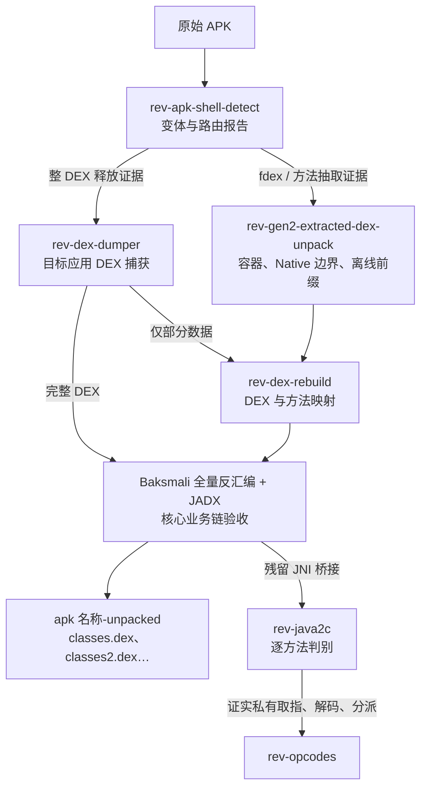

[English](README_EN.md) | 中文

# 逆向工程技能集 (Reverse Engineering Skills)

面向授权安全研究的逆向工程 Skills，延续原项目的轻量结构：每个模块以一份 `skills/<name>/SKILL.md` 为入口，只有确实需要执行的脚本、配置或二进制才与它同级存放。目前支持一代壳和二代抽取型壳的脱壳，已在多个 apk 上进行验证。

项目没有中央脱壳编排器。Agent 根据用户目标、样本证据和当前环境选择能力；针对一代完整 DEX 释放与二代方法抽取，按下述结构证据路由。各采集、仿真和重建工具仍可作为对应流程的组成部分。

## 流程索引



箭头表示证据和产物的流转；是否进入 Java2C 或 VMP 由恢复后的实际方法决定。

## Skills

| Skill | 作用 |
|---|---|
| `rev-symbol` | 从导入导出、反编译代码和运行时证据恢复函数语义 |
| `rev-struct` | 从内存访问模式和调用关系重建数据结构 |
| `rev-frida` | 使用现代 Frida API 生成动态插桩脚本 |
| `frida-hook-tool` | 已编译的 rt-gum KernelPatch + Frida Gum 工具包，用于适配设备上的内核辅助 Hook、Trace 和模块加载 |
| `rev-unicorn-debug` | 使用 Unicorn 模拟和调试局部机器码 |
| `rev-idapython` | IDAPython / IDALib 自动化参考 |
| `rev-u3d-dump` | 从 Unity IL2CPP 构建提取 C# 符号 |
| `rev-ios-dump` | 使用 frida-ios-dump 导出解密后的 iOS 应用 |
| `rev-dex-dumper` | 从运行中的 Android 应用内存导出 DEX |
| `rev-apk-shell-detect` | 可选的 APK 壳家族与自定义 loader 快速识别 |
| `rev-jni-env` | 建模和验证 Android/JNI 运行环境依赖 |
| `rev-gen2-extracted-dex-unpack` | 用 Unidbg 重放 Native 解密并还原二代动态抽取型 DEX 壳，验证为二代抽取型壳时使用 |
| `rev-java2c` | 追踪 JNI 桥接到 Native 方法，按方法恢复与验证 Java2C/Native 化逻辑 |
| `rev-opcodes` | 按 wrapper 恢复自定义 SO VMP，并生成反汇编器、独立模拟器和等价实现 |
| `rev-vm-coverage` | 分别统计 VMP 方法、指令点、虚拟边、raw opcode 槽、handler 与终点缺口 |
| `rev-kernel-dex-dumper` | 设计并校验 Akane + JDex2 适配的内核辅助采集 |
| `rev-dex-rebuild` | 校验并修复部分 DEX、code_item 或 smali 结果 |
| `rev-apk-repack` | 将验证后的 DEX 写入新的 unsigned APK |
| `rev-signer` | zipalign、实验室签名、证书检查和安装前验证 |

对当前已适配 Android 设备做 Frida 动态 Hook/采集时，必须先使用 `frida-hook-tool`。**禁止以 `frida-server` 作为该工具不可用时的回退。** 若缺 SuperKey、会话、内核适配或模块文件，先报告具体缺项；无密钥仍可做工具包校验和设备只读检查。当前主机的 SuperKey 路径见该 Skill，密钥内容不进入项目。

## 快速识别壳

```powershell
python -X utf8 skills/rev-apk-shell-detect/detect_apk_shell.py `
  'E:\path\to\target.apk' -o shell-report.json
```

输出为 `known_shell`、`custom_shell`、`no_shell` 或 `inconclusive`，并在证据足够时给出 `shell.variant`、`shell.generation`、`container_layout` 和 `routing.next_skill`。**识别出 Bangcle 等家族不等于识别出代际；以变体证据选择下一步。**

| 结构证据 | 优先流程 |
|---|---|
| 小型启动 DEX、运行时加载器，尚无可辨识的抽取容器证据（即使存在高熵尾部） | 先试 `rev-dex-dumper`；只有 dump 含应用自身类和核心方法才确认整 DEX 路线 |
| 主 DEX 有显著 overlay，出现 `dexdata0`、内部候选 `fdex` 段尾及 EOF `fdex`；或证实方法体逐个回填 | `rev-gen2-extracted-dex-unpack`；先容器/方法分诊，之后按需定向采集并用 `rev-dex-rebuild` 重建 |
| 只命中壳家族，或容器证据不足 | 继续调查布局与加载行为；不要直接假定一代或二代 |

详细判据见 [Skill 路由索引](skills/README.md)。`fdex` 内部段尾数是静态候选值，须用解密后的 DEX 长度确认。二代流程可以使用内存采集作证据，但整机 DEX dump 不是其默认入口或完成标准。

已遇到的抽取型壳加解密思路按壳名收录在[壳型档案](skills/rev-gen2-extracted-dex-unpack/shell-profiles/README.md)；每份档案是新样本的分析线索，不提供固定密钥或参数。

二代样本若经 Native 代码或独立向量确认使用标准 SM4-ECB，可在 `rev-gen2-extracted-dex-unpack` 中用 `sm4_key_scan.py` 默认扫描完整捕获集，并用 `decrypt_prefixes.py` 离线解密前缀后交给 `rev-dex-rebuild`。设备前缀仅供诊断和独立比对。密钥来源、段偏移、对齐和加密范围必须对当前样本重新验证；不能从壳家族名推断算法。

`no_shell` 只表示没有发现 APK loader 壳，不表示 native SO 未受保护。若存在混淆 JNI wrapper、解释器热点、字节码取指或其他 VMP 证据，仍需进行 native/VMP 分析。

## 抽取型 DEX 与 Java2C 的交接

二代抽取型壳经 `rev-gen2-extracted-dex-unpack` 重放并由 `rev-dex-rebuild` 校验后，若对应范围的 `classes*.dex`、方法映射和核心业务逻辑均已恢复并验收，就可以对抽取层结项。恢复后的方法若仍调用 `JniLib.cV/cI/cL` 等 JNI 桥接，把精确方法原型、分发编号、APK/SO 哈希和 DEX 对应关系交给 `rev-java2c`，判别 Dalvik 回填、Native 实现或私有 VM。桥接调用本身只证明转发，尚不足以证明原始 Java 实现已转换，也不足以证明存在 VMP。若发现 ID 索引的私有程序表，可在应用初始化后只读批量采集，无需逐个点击业务界面；登录/隐私页是否阻止表初始化应在目标应用上验证。批量伪造参数调用 `JniLib` 不能替代语义还原。

按证据选择后续：`rev-gen2-extracted-dex-unpack` → `rev-dex-rebuild` 完成抽取型 DEX；若核心业务已还原且无相关 Native 桥接，可直接结项。存在残留桥接时才用 `rev-java2c` 逐方法判别延迟 Dalvik 回填、普通 Native/JNI 实现或私有 VM；只有确认私有字节码取指、解码和 handler 分派，才用 `rev-opcodes`。二代抽取型壳不必然接 VMP。

## SO VMP 路线

第三代 VMP 不以“dump 出完整 DEX”为目标，默认按一个 JNI wrapper 或字节码方法恢复。先区分外层 OLLVM/CFF 与真正的内层字节码解释器，再在取指边界采集窄范围 trace。一条虚拟指令必须包含 handler 入口、外层 CFF 状态块，直到下一次取指或终点，不能只看入口几条指令。

VMP/大型 OLLVM 函数的静态分析只能使用 IDA-NO-MCP 批量导出，不得调用 IDA MCP，也不得把它作为补充查询或失败兜底。定位解释器后必须落盘带哈希的原始指令级 trace；热点与基本块摘要只用于缩小采集范围。

用 `rev-symbol` 对每条指令片段做 bounded angr + concrete trace 恢复，随后建立 opcode/operand 表、反汇编器和独立 VM 模拟器。只有全部可行字节码路径都能逐状态重放，并与 unidbg/真机的返回值、字段写入、异常、buffer 和 JNI 副作用一致，才称该范围完整去虚拟化；`rev-vm-coverage` 用于证明 expected universe 和剩余缺口。

## 内核辅助路线

- Akane Injector: https://github.com/aimardcr/akane-injector
- JDex2: https://github.com/J5now/JDex2

Akane 注入 native `.so`，JDex2 原本依赖 Xposed/LSPosed，因此二者结合需要目标版本适配的 native payload 和 JNI/ART bridge，不是把 JDex2 模块原样注入。使用前阅读 `rev-kernel-dex-dumper` 的兼容性、安全和清理约束。

## APK 分析工作区

分析任何 APK 时，都在 `work/<apk名>-<SHA256前12位>.apk_work/` 建立独立目录，避免不同样本的日志、dump 和结论混用。普通脱壳的中间产物只要求使用该独立目录，内部结构由 Agent 自行决定；最终交付目录采用下述统一命名。只有 VMP、长时间动态分析和多轮回放必须记录检查点。规则见 [work/README.md](work/README.md)，样本工作区默认不提交 Git。

## 脱壳结果交付

在对应的独立分析工作区内，把最终供用户查看的文件统一放入 `<源 APK 文件名去掉 .apk>-unpacked/`。例如 `039_com.imusic.iting_5.8.5.apk` 对应 `work/039_com.imusic.iting_5.8.5-<SHA256前12位>.apk_work/039_com.imusic.iting_5.8.5-unpacked/`。工作区继续按哈希隔离样本，`-unpacked` 目录只承载该样本的交付结果。

恢复后的 `classes.dex`、`classes2.dex` 等直接放在交付目录顶层，附上哈希、结构校验、原始样本对应关系和恢复范围说明。**抽取型壳交付前，必须用 Baksmali 对全部最终 DEX 成功反汇编并保存日志与 Smali 结果；同时用 JADX 提供可浏览的 Java 源码及原壳 DEX 对照。**

**主要和核心业务逻辑确实还原、可读且可核验，才可将抽取型壳脱壳标为完成；否则标为部分恢复。** 报告必须沿样本实际业务调用链展示关键方法的原占位与恢复后 CodeItem 对应关系、可读的判断分支、输入输出和业务副作用；不能以 DEX 头部有效、类数量或打开 JADX 成功代替业务验收。对仍为 JNI/Native 桥接或 JADX 无法反编译的关键方法，明确写出未恢复范围和数量，不能宣称这些方法的 Java 语义已还原。详见 [中文版复用流程](skills/rev-gen2-extracted-dex-unpack/references/extracted-dex.zh-CN.md)。

## 安装

```bash
npx skills add P4nda0s/reverse-skills
```

## 许可证

MIT
