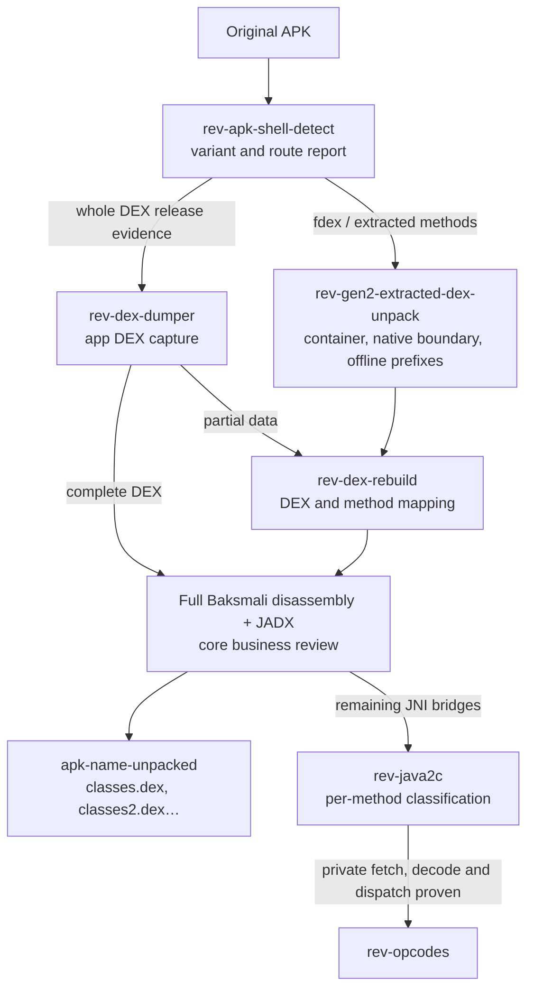

English | [中文](README.md)

# Reverse Engineering Skills

Reverse-engineering Skills for authorized security research. The repository keeps the original lightweight layout: each module is entered through `skills/<name>/SKILL.md`, with only necessary scripts, data, or binaries placed beside it.Unpacking is currently supported for both first-generation shells and second-generation extractable shells, and has been verified on multiple APKs.

There is no central unpacking orchestrator. Choose the workflow from the sample's structure, especially whether it releases a whole DEX or extracts method bodies. Acquisition, emulation, and rebuilding tools can still support the selected workflow.

## Workflow map



Arrows show evidence and artifact flow. Whether Java2C or VMP follows depends on the recovered methods.

## Skills

| Skill | Purpose |
|---|---|
| `rev-symbol` | Recover function semantics from imports, decompilation, and runtime evidence |
| `rev-struct` | Reconstruct structures from memory access and call relationships |
| `rev-frida` | Generate dynamic instrumentation with modern Frida APIs |
| `frida-hook-tool` | Bundled rt-gum KernelPatch + Frida Gum runtime for kernel-assisted hooks, traces, and modules on its validated device profile |
| `rev-unicorn-debug` | Emulate and debug local machine-code fragments with Unicorn |
| `rev-idapython` | IDAPython / IDALib automation reference |
| `rev-u3d-dump` | Extract C# symbols from Unity IL2CPP builds |
| `rev-ios-dump` | Export decrypted iOS applications with frida-ios-dump |
| `rev-dex-dumper` | Dump DEX files from a running Android process |
| `rev-apk-shell-detect` | Optionally identify common packers or custom APK loaders |
| `rev-jni-env` | Model and validate Android/JNI runtime dependencies |
| `rev-gen2-extracted-dex-unpack` | Replay native decryption with unidbg and restore second-generation extracted-method DEX shells, to be used when verifying a second-generation extractable shell |
| `rev-java2c` | Trace JNI bridges to native methods and recover validated Java2C/nativeized behavior per method |
| `rev-opcodes` | Devirtualize a custom SO VMP per wrapper and build a disassembler, independent emulator, and equivalent implementation |
| `rev-vm-coverage` | Measure VMP method, instruction-site, virtual-edge, raw-opcode-slot, handler, and terminal gaps |
| `rev-kernel-dex-dumper` | Design and validate Akane + JDex2-adapter kernel acquisition |
| `rev-dex-rebuild` | Validate and repair partial DEX, code_item, or smali results |
| `rev-apk-repack` | Put validated DEX files into a new unsigned APK |
| `rev-signer` | Zipalign, lab-sign, inspect certificates, and verify an APK |

For dynamic Frida hooking or collection on the validated Android device, use `frida-hook-tool` first. **Do not fall back to `frida-server` when this tool is unavailable.** Report the missing SuperKey, session, kernel adaptation, or module file. Bundle verification and read-only device checks remain available without a key; the host's SuperKey path is documented in the Skill, and the key value is not bundled.

## Quick Shell Check

```powershell
python -X utf8 skills/rev-apk-shell-detect/detect_apk_shell.py `
  'E:\path\to\target.apk' -o shell-report.json
```

The result is `known_shell`, `custom_shell`, `no_shell`, or `inconclusive`. Where evidence permits, it also reports `shell.variant`, `shell.generation`, `container_layout`, and `routing.next_skill`. **A family match such as Bangcle does not establish the generation.**

| Structural evidence | First workflow |
|---|---|
| Small bootstrap DEX and runtime loader without recognizable extraction-container evidence (even if an opaque overlay is present) | Try `rev-dex-dumper` first; confirm the whole-DEX route only if captures contain the app's own classes and core methods |
| Large primary-DEX overlay with `dexdata0`, candidate interior `fdex` trailers and EOF `fdex`, or confirmed per-method refill | `rev-gen2-extracted-dex-unpack`; triage container/methods first, then use targeted acquisition and `rev-dex-rebuild` as needed |
| Family match only, or incomplete container evidence | Inspect the layout and loader path before choosing either workflow |

See the [Skill routing index](skills/README.md) for the full decision tree. Interior `fdex` markers are candidate segment trailers until decrypted DEX lengths confirm them. A memory dump may provide evidence for the second-generation workflow; it is not its default entry or completion criterion.

The [extracted-shell profiles](skills/rev-gen2-extracted-dex-unpack/shell-profiles/README.md) record observed container, key-search, and decrypt workflows by shell family. Treat each profile as leads to verify on the current APK, not as fixed keys or parameters.

When the current sample's native code or independent vectors establish standard SM4-ECB, `rev-gen2-extracted-dex-unpack` provides `sm4_key_scan.py` to scan the complete captured set by default and `decrypt_prefixes.py` for offline prefix recovery before `rev-dex-rebuild`. Device prefixes are for diagnostics and independent comparison only. Verify the key source, segment offsets, alignment, and encrypted extent anew; the shell family does not establish the cipher.

`no_shell` means only that no APK loader shell was found. It does not exclude native protection. Obfuscated JNI wrappers, interpreter hotspots, bytecode fetches, or other established VMP evidence still require native/VMP analysis.

## Extracted DEX to Java2C handoff

After `rev-gen2-extracted-dex-unpack` replay and `rev-dex-rebuild` validation, the second-generation extracted-DEX scope is complete when its `classes*.dex` files, method mappings, and core business logic are restored and checked. If recovered methods still call JNI bridges such as `JniLib.cV/cI/cL`, pass their exact prototypes, dispatch IDs, APK/SO hashes, and DEX mappings to `rev-java2c` to distinguish Dalvik refill, native implementations, and a private VM. A bridge establishes delegation, but alone does not prove that original Java was converted or that the SO contains a VMP. When an initialized ID-indexed private program table exists, read-only bulk collection can avoid triggering each business screen; verify whether login or privacy gates delay table initialization on the actual app. Calling every `JniLib` ID with fake arguments cannot substitute for semantic recovery.

Choose the next step from evidence: `rev-gen2-extracted-dex-unpack` → `rev-dex-rebuild` completes the extracted DEX scope; finish there when the requested core logic is restored and no relevant native bridge remains. For residual bridges, use `rev-java2c` to distinguish delayed Dalvik refill, ordinary native/JNI behavior, and private VMs per method. Use `rev-opcodes` only after private bytecode fetch, decode, and handler dispatch are proven. A second-generation extraction shell does not imply VMP.

## SO VMP Route

Third-generation VMP recovery does not aim to dump a whole DEX; scope it to one JNI wrapper or bytecode method by default. Separate outer OLLVM/CFF from the true inner bytecode interpreter, then capture a narrow trace at the fetch boundary. One virtual instruction includes the handler entry and all outer CFF states through the next fetch or terminal, not merely the first handler instructions.

For VMP or large OLLVM functions, use only an IDA-NO-MCP batch export. Do not call IDA MCP, including for supplemental queries or as a fallback. After locating the interpreter, persist a hashed raw instruction-level trace. Hotspot and basic-block summaries are only range-discovery evidence.

Use `rev-symbol` for bounded angr plus concrete-trace recovery of each instruction slice, then build the opcode/operand table, disassembler, and independent VM emulator. Call the scope fully devirtualized only when every feasible bytecode path replays instruction by instruction and matches unidbg/device returns, field writes, exceptions, buffers, and JNI side effects. Use `rev-vm-coverage` to prove the expected universe and remaining gaps.

## Kernel-Assisted Route

- Akane Injector: https://github.com/aimardcr/akane-injector
- JDex2: https://github.com/J5now/JDex2

Akane injects native shared libraries while JDex2 normally runs through Xposed/LSPosed. Combining them requires a target-version native payload plus a JNI/ART bridge; it is not a direct injection of the original JDex2 module. Read the compatibility, safety, and cleanup requirements in `rev-kernel-dex-dumper` first.

## APK Analysis Workspaces

Create an isolated `work/<apk-name>-<sha256-first12>.apk_work/` directory for every APK analysis so logs, dumps, and conclusions cannot cross samples. Intermediate files may use any internal layout; final results follow the directory name below. Checkpoints are mandatory only for VMP, long dynamic runs, and repeated replay. See [work/README.md](work/README.md). Case workspaces are ignored by Git by default.

## Unpacked Result Directory

Inside the isolated analysis workspace, put user-facing results in `<source-apk-filename-without-.apk>-unpacked/`. For example, `039_com.imusic.iting_5.8.5.apk` produces `work/039_com.imusic.iting_5.8.5-<sha256-first12>.apk_work/039_com.imusic.iting_5.8.5-unpacked/`. Keep the hash-qualified workspace for sample isolation.

Place recovered `classes.dex`, `classes2.dex`, and later DEX files at the result directory root. Include hashes, structural validation, source identity, and the exact recovery scope. **Before delivering an extracted-method shell result, successfully disassemble every final DEX with Baksmali and retain its log and Smali output.** Also provide browsable JADX Java output and a separate baseline of the original shell DEX.

**Mark an extracted-method shell unpacking complete only when the app's main and core business logic is restored, readable, and verifiable; otherwise label it partial recovery.** Follow real business call chains and show the original placeholder to restored CodeItem mapping, readable decisions, inputs, outputs, and effects. Valid headers, class counts, or a successful JADX launch alone do not establish this. Quantify key methods that still dispatch to JNI/native code or fail Java decompilation and state their unrecovered scope. See the [Chinese workflow](skills/rev-gen2-extracted-dex-unpack/references/extracted-dex.zh-CN.md).

## Installation

```bash
npx skills add P4nda0s/reverse-skills
```

## License

MIT
